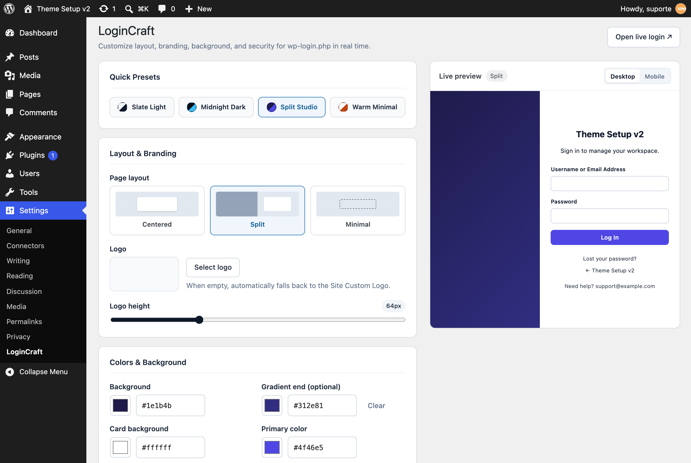
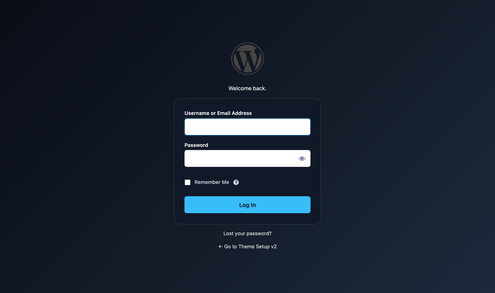
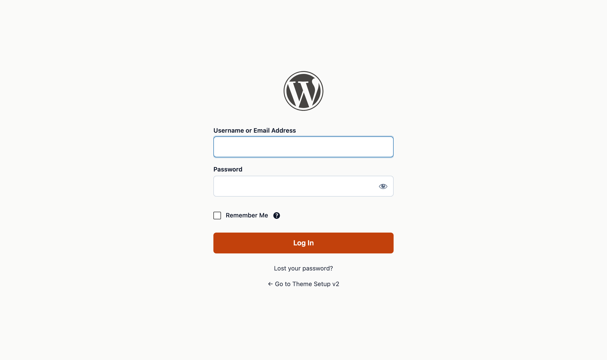

# LoginCraft

[](https://github.com/HeyRenan/logincraft/actions/workflows/ci.yml)
&nbsp;[](LICENSE)
&nbsp;[](https://wordpress.org)
&nbsp;[](https://php.net)

A lightweight, zero-dependency WordPress login customizer with a real-time side-by-side preview, 3 responsive layouts, WCAG auto-contrast, and security hygiene.

No jQuery in the settings UI, no frontend queries (`autoload = false`), no upsells, and no bloat.



## Layouts

| Split Studio | Midnight Dark | Warm Minimal |
| :---: | :---: | :---: |
|  |  |  |

## Features

- **3 polished layouts**: `Centered`, `Split` (editorial aside + clean form), and `Minimal`.
- **4 one-click presets**: `Slate Light`, `Midnight Dark`, `Split Studio`, and `Warm Minimal`.
- **Real-time Live Preview**: pure Vanilla JS preview inside **Settings → LoginCraft** matching `wp-login.php`, with Desktop/Mobile viewport toggle.
- **Brand & visual controls**: custom logo with height slider (falls back to the site's Custom Logo), solid or gradient background, background image with adjustable overlay, dark/light card support, and border radius presets (`0px`, `8px`, `16px`).
- **Automatic WCAG contrast**: calculates relative luminance for button text, dark cards, and outer links.
- **UX & security hygiene**: optional welcome/footer text, hide language switcher, hide "Back to site" link, generic login error message (prevents username enumeration without masking password-reset errors), `interim-login` safe handling, and sanitized Custom CSS.
- **Portable JSON Export & Import**: transfer layout, colors, copy, toggles, and Custom CSS across sites while keeping local media IDs separate.
- **Clean data footprint**: single `logincraft_settings` option stored with `autoload = false`, nonce-protected reset, and full cleanup via `uninstall.php`.

## Installation

### From Release ZIP (recommended)

1. Download `logincraft.zip` from [Releases](https://github.com/HeyRenan/logincraft/releases).
2. In WordPress admin, go to **Plugins → Add New → Upload Plugin** and activate **LoginCraft**.
3. Configure at **Settings → LoginCraft**.

### Composer

```bash
composer require heyrenan/logincraft
```

### Manual / Git

```bash
cd wp-content/plugins
git clone https://github.com/HeyRenan/logincraft.git
```

## Developer Hooks

```php
// Override default settings
add_filter( 'logincraft_defaults', function ( array $defaults ): array {
    $defaults['primary_color'] = '#2563eb';
    return $defaults;
} );

// Filter resolved options at runtime
add_filter( 'logincraft_options', function ( array $options ): array {
    return $options;
} );

// Customize CSS custom properties injected on wp-login.php
add_filter( 'logincraft_css_vars', function ( array $vars, array $options ): array {
    $vars['--lc-radius'] = '12px';
    return $vars;
}, 10, 2 );

// Customize the generic login error message
add_filter( 'logincraft_error_message', function ( string $message ): string {
    return '<strong>Error:</strong> Invalid username or password.';
} );
```

## Development & Tests

```bash
find . -name '*.php' -print0 | xargs -0 -n1 php -l
node --check assets/admin.js
php tests/run.php
```

[Contributing](CONTRIBUTING.md) · [Security](SECURITY.md) · [Changelog](CHANGELOG.md)
